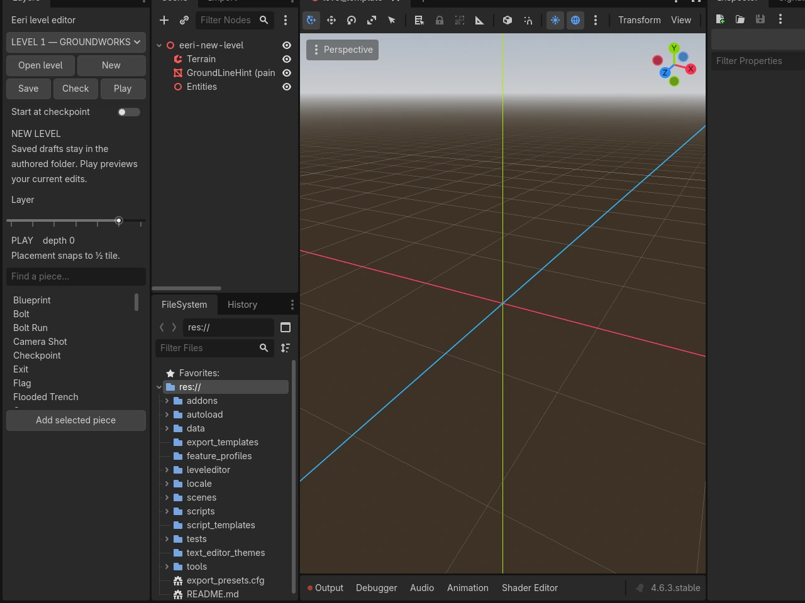
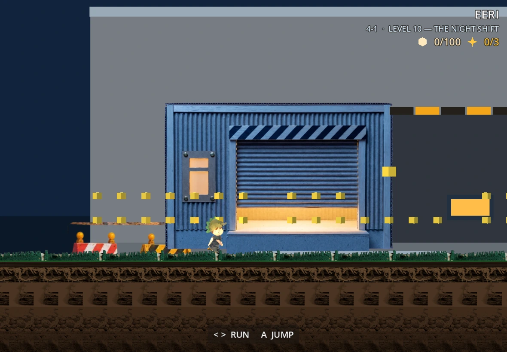
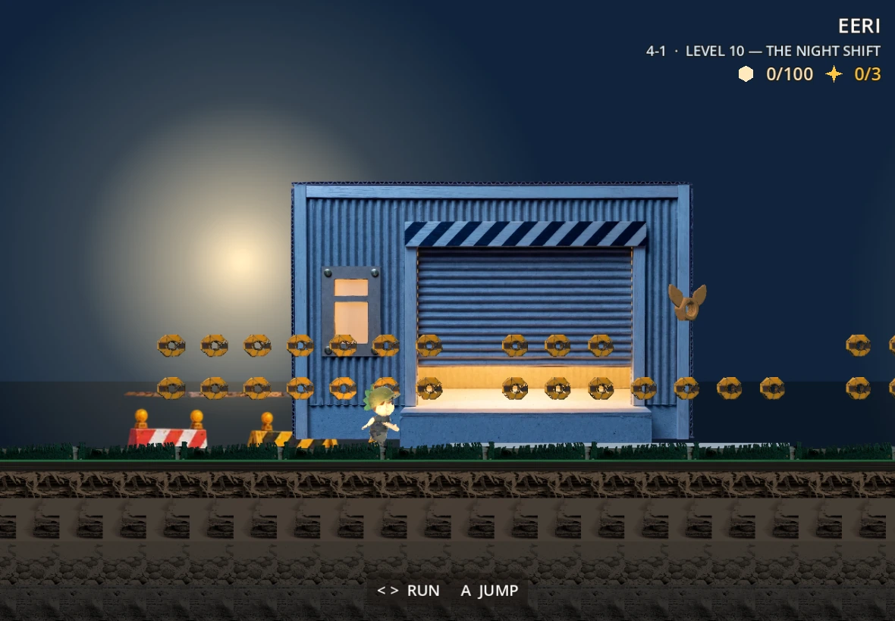
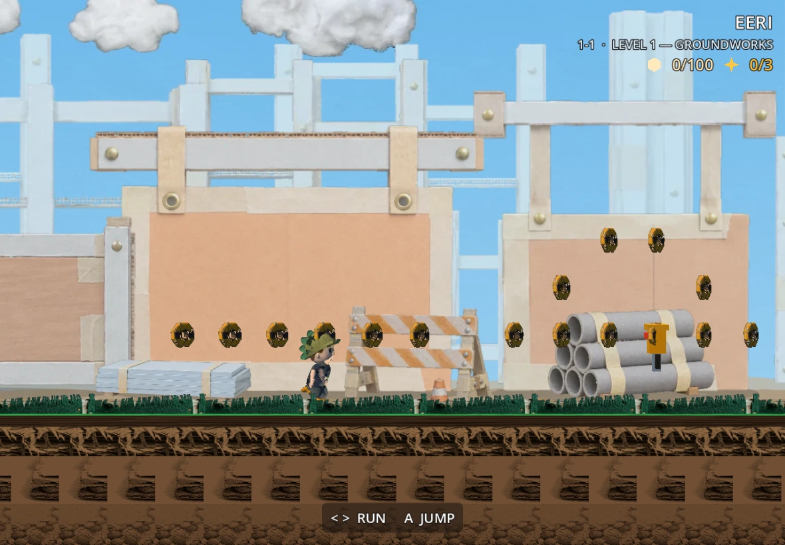
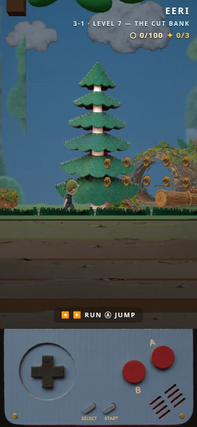
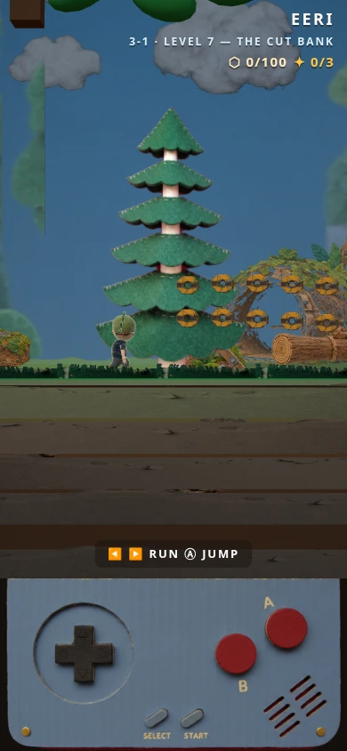

# Eeri editor and polish source milestone

These are review captures of `ship/eeri-editor-polish`, not the public release.
Full PNG originals and test logs are in `/workspace/eeri-audit/`; the WebP copies
here preserve their dimensions and have no visual edits. Browser setup uses
debug level selection; movement/completion checks run separately.

## Authoring

The Layers dock exposes open/new/save/check/play, checkpoint start, layer
readout, art search with real thumbnails and native undo/redo. The real plugin
command paths pass 10 checks. This is a static graphical capture, not evidence
of a completed pointer-driven session: this environment's graphical editor
stalls after its first frame. The ten-minute manual authoring gate remains open.

## Depot and pickups

Before: the legacy loading-dock wall hides authored scenery and the pickups
are colored boxes.

After: canonical dock artwork, shared radial work lamps, night palette/fringe,
and catalog bolt/wing-nut models. Both captures are 1180×820; framing differs
slightly because they are separate moving game launches.

The ordinary and golden pickups retain shared MultiMesh instancing. Existing
painted textures and matte materials provide their identity.

## Grove depth repair

The same 390×844 browser scene, with the placed-cutout depth bias disabled
and enabled. The backdrop and tree share the NEAR depth. The tree stripes
disappear when its fragments receive a small depth bias; authored coordinates,
art and collision are unchanged. Pickups continue rotating between frames.

## Checks and limits

Godot 4.6.3: 18 test scenes / 497 checks; editor controls 10; scenery source
application 12; all seven generated-data drift checks pass. Browser: smoke 437,
editor 9, room contracts 246, FX 31, dev contracts 36 and World 1 clock-out 21
pass. The final integrated browser runtime passes the 12-level bot (25 checks,
zero ride losses and no page errors). Its CSS viewport is 480×270 with device
pixel ratio 0.25 to reduce software-raster cost; portrait captures use 390×844.

`node godot/tools/verify.mjs` records commit/tree, engine, dirty state and full
outputs in ignored `build/verification.json`. Existing Godot shutdown resource
warnings are retained; runtime/script errors fail the run. Physical phone,
M2 iPad/DualSense and hands-on authoring acceptance are still unverified. CI,
matching release templates, export receipts and publication remain separate
work. See [the current shipping plan](../../SESSION_HANDOFF.md).
